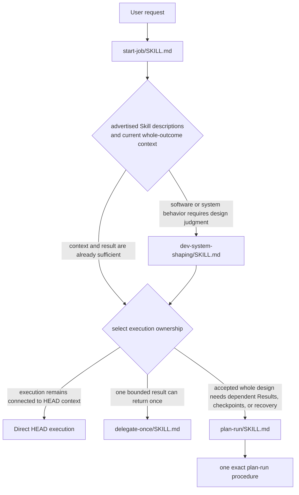
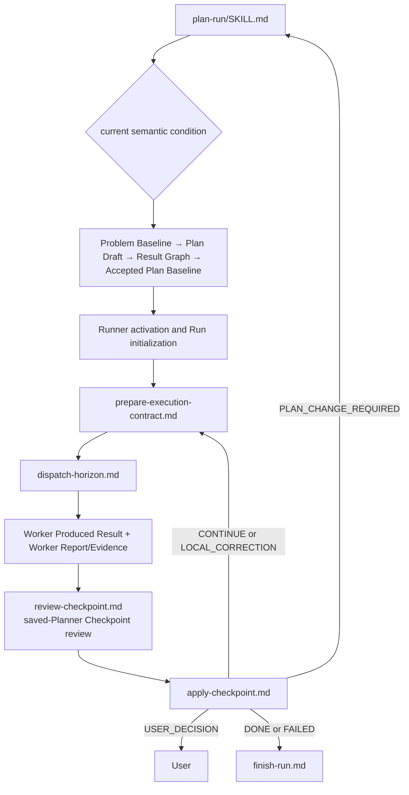

# HEAD Instruction Routing Map

[Back to task instructions](01-instructions-on-demand.md) · [한국어](ko/instruction-routing-map.md)

This map shows how advertised Skills select a top-level workflow and how that workflow reads one exact procedure for the current condition. `HEAD_CORE.md` supplies stable ownership and judgment principles; it is not a file or workflow router.

## Instruction Surfaces

```text
Always loaded principles
└── packages/core/head/HEAD_CORE.md

Advertised workflow surface
└── packages/skills/*/SKILL.md

Condition-selected procedure surface
└── packages/procedures/**/*.md
```

## Overall Routing



## Routing Inside `plan-run`



The Accepted Plan Baseline selects Results and checkpoint meaning. The Runner authors Execution Contracts and dispatches only selected work. Workers produce Results and Report/Evidence; they do not supply planning authority. A local correction is an explicit delta against its original frozen Execution Contract.

## Role Index

| Instruction surface | Role | Selection condition |
|---|---|---|
| `packages/skills/start-job/SKILL.md` | Work-start card | Any new work |
| `packages/skills/plan-run/SKILL.md` | Route durable Plan production | Dependent Results, checkpoints, or recovery are needed |
| `packages/procedures/plan-run/planning/` | Planner: preserve Problem Baseline, form Plan Draft and Result Graph, accept Plan Baseline, activate Runner | Current planning transition |
| `packages/procedures/plan-run/results/` | Runner: select horizon, prepare Execution Contract, dispatch horizon | Selected Result or horizon operation |
| `packages/procedures/plan-run/workers/` | Worker readiness | Result selects a worker class |
| `packages/procedures/plan-run/run/` | Run initialization, saved-Planner checkpoint review, checkpoint application, recovery, stopping, and finishing | Current Run lifecycle transition |

## Loaded Volume

```text
Always loaded = Core and project base instructions
Advertised = genuine top-level Skills
Conditionally loaded = one Skill body + one exact procedure + only authority/evidence that can change it
```

Load `start-job` before any work. Then load the matching work-type skill for that class of work. Always-on Core is not a substitute once work context has grown. Do not re-inject Core into the system prefix.
