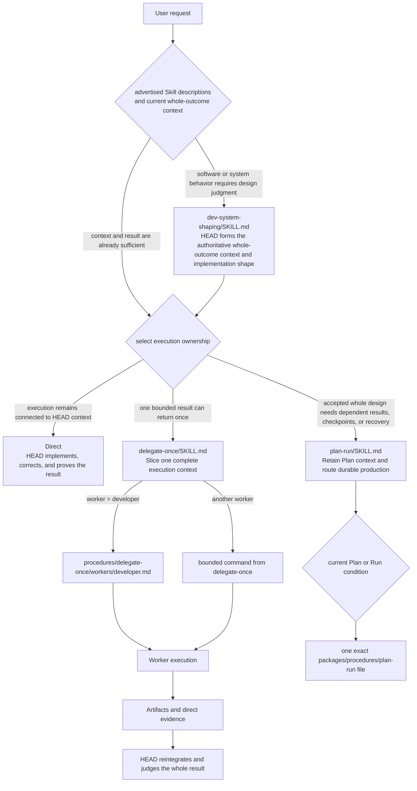
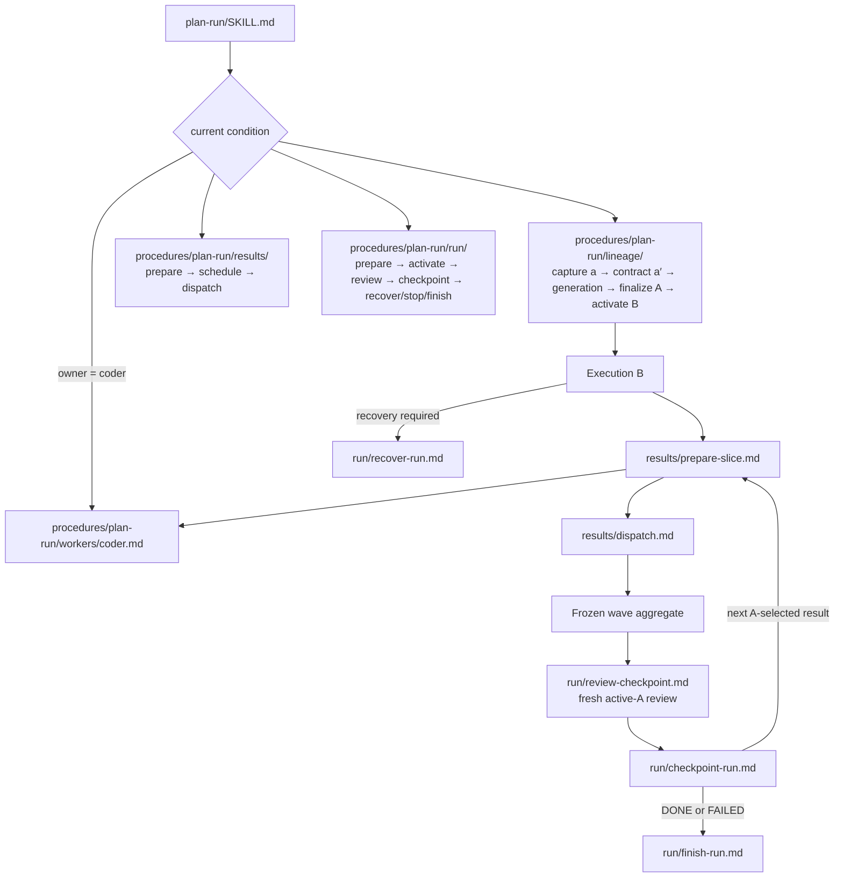

# HEAD Instruction Routing Map

[Back to task instructions](01-instructions-on-demand.md) · [한국어](ko/instruction-routing-map.md)

This map shows how advertised Skill descriptions select a top-level workflow and how that workflow reads one exact procedure for the current condition. `HEAD_CORE.md` supplies stable ownership and judgment principles; it is not a file or workflow router. Project-specific workflows are outside this shared map.

## Instruction Surfaces

```text
Always loaded principles
└── packages/core/head/HEAD_CORE.md

Advertised workflow surface
└── packages/skills/*/SKILL.md

Condition-selected procedure surface
└── packages/procedures/**/*.md
```

A Skill is directly selectable from a request or a completed HEAD judgment and owns a coherent workflow. A procedure has no independent entry: a selected Skill, accepted Plan state, worker selection, or Run state names it as the next exact file.

## Overall Routing



## Routing Inside `plan-run`

`plan-run/SKILL.md` contains the condition-to-file links. The linked procedure files live outside Skill discovery and are not independently advertised.

### Lineage Legend

| Symbol | Meaning |
|---|---|
| `a` | Immutable baseline preserving HEAD's directly investigated whole-outcome context |
| `P` | The sole mainline planning HEAD continuing the accepted planning work |
| `a′` | Clean user-agreed design context created from `a` and the Plan Contract |
| `A` | Immutable accepted execution authority containing the final Plan and initial route |
| `B` | The sole mainline execution HEAD derived from `A` that replaces `P` |



When a lineage procedure saves, loads, or migrates a HEAD, it also reads `packages/procedures/plan-run/lineage/anchor-operations.md`. No operation loads all lineage, result, worker, and Run procedures together.

## Role Index

| Instruction surface | Role | Selection condition |
|---|---|---|
| `packages/core/head/HEAD_CORE.md` | Stable whole-outcome ownership and judgment principles | Always |
| `packages/skills/dev-system-shaping/SKILL.md` | Form the authoritative whole-outcome context and smallest implementation shape | Software or system behavior requires design judgment |
| `packages/skills/delegate-once/SKILL.md` | Slice and return one independently executable bounded result | HEAD already holds the whole context and one result can return once |
| `packages/procedures/delegate-once/workers/developer.md` | Developer-local inspection, implementation, correction, and proof contract | `delegate-once` selected `developer` |
| `packages/skills/plan-run/SKILL.md` | Retain accepted Plan context and select one current durable-production procedure | Dependent bounded results, meaningful checkpoints, or durable recovery are required |
| `packages/procedures/plan-run/lineage/` | Preserve and transform Plan context from `a` through `A` and `B` | Exact lineage transition is current |
| `packages/procedures/plan-run/workers/` | Apply the selected Run worker-readiness contract | Plan or result selected that worker class |
| `packages/procedures/plan-run/results/` | Prepare, schedule, freeze, and dispatch exact A-selected results | Exact result or horizon operation is current |
| `packages/procedures/plan-run/run/` | Prepare, activate, review, checkpoint, recover, stop, or finish the active Run | Exact Run lifecycle transition is current |

## Loaded Volume

```text
Always loaded
= Core and project base instructions

Advertised
= names and descriptions of genuine top-level Skills

Conditionally loaded
= one selected Skill body
+ one exact linked procedure
+ only the authority and evidence that can change that operation
```

The model does not choose from a flat catalogue of internal phases. Skill descriptions select the coherent workflow; current accepted state selects the exact external procedure.
