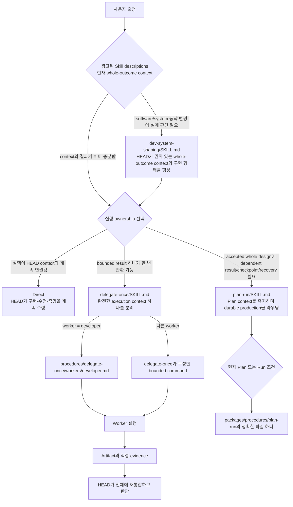
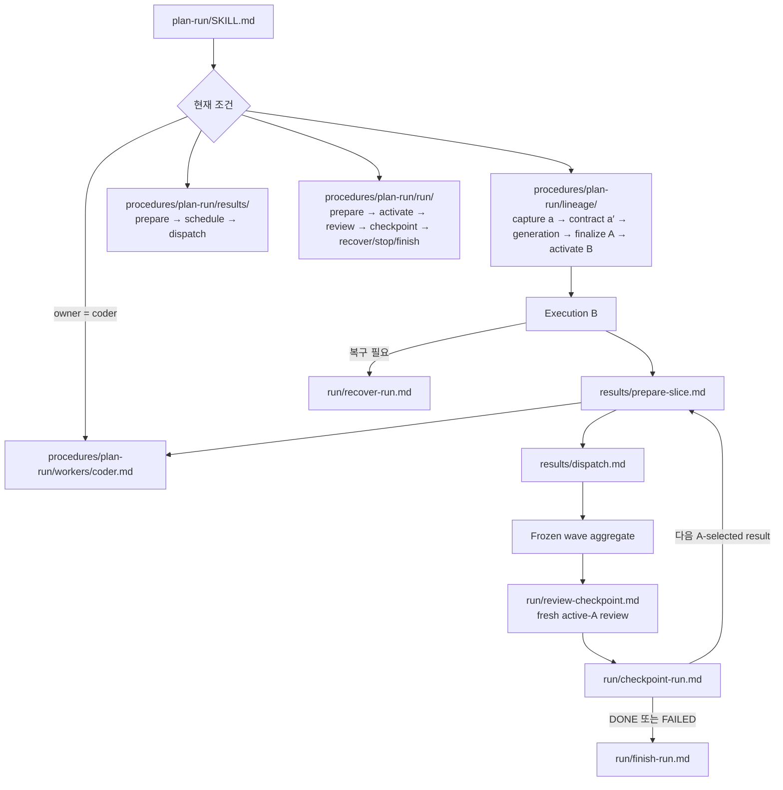

# HEAD 지침 라우팅 지도

[작업 지침 글로 돌아가기](01-instructions-on-demand.md) · [English](../instruction-routing-map.md)

이 지도는 광고된 Skill description이 top-level workflow를 선택하고, 선택된 workflow가 현재 조건에 맞는 procedure 하나를 읽는 흐름을 보여준다. `HEAD_CORE.md`는 안정적인 ownership과 판단 원칙을 제공하며 파일이나 workflow를 라우팅하지 않는다. 프로젝트별 workflow는 이 공통 지도에 포함하지 않는다.

## 지침 표면

```text
항상 읽는 원칙
└── packages/core/head/HEAD_CORE.md

광고되는 workflow 표면
└── packages/skills/*/SKILL.md

조건에 따라 선택되는 procedure 표면
└── packages/procedures/**/*.md
```

Skill은 사용자 요청이나 완료된 HEAD 판단에서 직접 선택할 수 있고 하나의 완결된 workflow를 소유한다. Procedure는 독립 진입점이 없으며, 선택된 Skill·승인된 Plan 상태·worker 선택·Run 상태가 다음에 읽을 정확한 파일을 지정한다.

## 전체 라우팅



## `plan-run` 내부 라우팅

`plan-run/SKILL.md`가 조건별 파일 링크를 가진다. 링크된 procedure 파일은 Skill discovery 밖에 있으며 독립 Skill로 광고되지 않는다.

### 계보 기호

| 기호 | 의미 |
|---|---|
| `a` | HEAD가 직접 조사한 whole-outcome context를 보존하는 변경 불가능한 기준점 |
| `P` | 합의된 계획 작업을 계속하는 유일한 메인라인 planning HEAD |
| `a′` | `a`와 Plan Contract로 만든 깨끗한 사용자 합의 design context |
| `A` | 최종 Plan과 초기 route를 담은 변경 불가능한 승인 실행 authority |
| `B` | `A`에서 파생되어 `P`를 교체하는 유일한 메인라인 execution HEAD |



Lineage procedure가 HEAD를 save·load·migrate할 때는 `packages/procedures/plan-run/lineage/anchor-operations.md`도 읽는다. 어떤 동작도 lineage·result·worker·Run procedure 전체를 함께 읽지 않는다.

## 역할 인덱스

| 지침 표면 | 역할 | 선택 조건 |
|---|---|---|
| `packages/core/head/HEAD_CORE.md` | 안정적인 whole-outcome ownership과 판단 원칙 | 항상 |
| `packages/skills/dev-system-shaping/SKILL.md` | 권위 있는 whole-outcome context와 가장 작은 구현 형태를 형성 | Software/system 동작 변경에 설계 판단이 필요할 때 |
| `packages/skills/delegate-once/SKILL.md` | 독립 실행 가능한 bounded result 하나를 분리하고 한 번 반환 | HEAD가 전체 context를 보유하고 결과 하나가 한 번 반환 가능할 때 |
| `packages/procedures/delegate-once/workers/developer.md` | Developer의 local 조사·구현·수정·증명 계약 | `delegate-once`가 `developer`를 선택했을 때 |
| `packages/skills/plan-run/SKILL.md` | 승인된 Plan context를 유지하며 현재 durable-production procedure 하나를 선택 | Dependent bounded result, 의미 있는 checkpoint, durable recovery가 필요할 때 |
| `packages/procedures/plan-run/lineage/` | `a`에서 `A`와 `B`까지 Plan context를 보존·전환 | 해당 lineage 전환이 현재일 때 |
| `packages/procedures/plan-run/workers/` | 선택한 Run worker의 readiness contract를 적용 | Plan 또는 result가 해당 worker class를 선택했을 때 |
| `packages/procedures/plan-run/results/` | 정확한 A-selected result를 준비·일정화·고정·dispatch | 해당 result 또는 horizon 동작이 현재일 때 |
| `packages/procedures/plan-run/run/` | 활성 Run을 준비·활성화·review·checkpoint·복구·중지·완료 | 해당 Run lifecycle 전환이 현재일 때 |

## 읽는 양

```text
항상 읽는 것
= Core와 project base instructions

광고되는 것
= genuine top-level Skill의 이름과 description

조건에 따라 읽는 것
= 선택한 Skill body 하나
+ 링크된 정확한 procedure 하나
+ 그 동작을 바꿀 수 있는 authority와 evidence만
```

모델은 내부 phase의 평평한 목록에서 고르지 않는다. Skill description이 완결된 workflow를 선택하고, 현재 승인 상태가 외부 procedure 하나를 선택한다.
