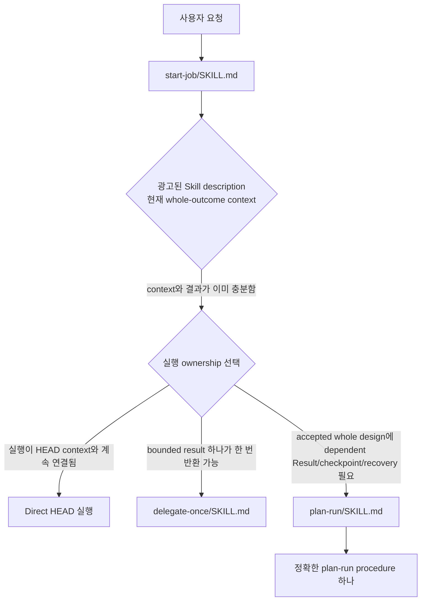
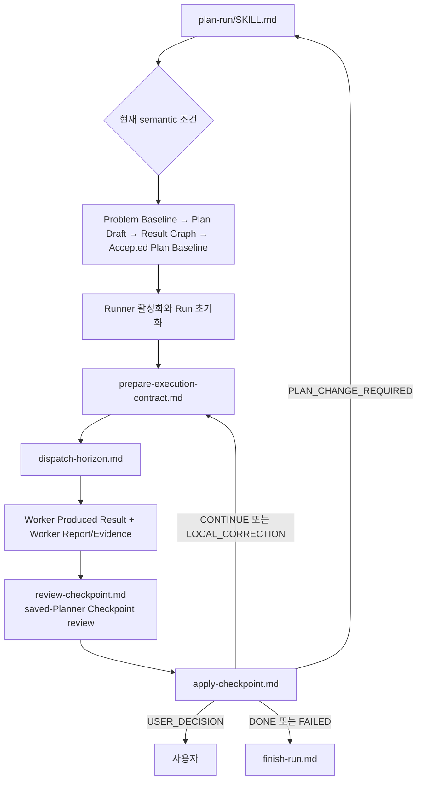

# HEAD 지침 라우팅 지도

[작업 지침 글로 돌아가기](01-instructions-on-demand.md) · [English](../instruction-routing-map.md)

이 지도는 광고된 Skill이 top-level workflow를 선택하고, 선택된 workflow가 현재 조건에 맞는 procedure 하나를 읽는 흐름을 보여 준다. `HEAD_CORE.md`는 안정적인 ownership과 판단 원칙을 제공하며 파일이나 workflow를 라우팅하지 않는다.

## 지침 표면

```text
항상 읽는 원칙
└── packages/core/head/HEAD_CORE.md

광고되는 workflow 표면
└── packages/skills/*/SKILL.md

조건에 따라 선택되는 procedure 표면
└── packages/procedures/**/*.md
```

## 전체 라우팅



## `plan-run` 내부 라우팅



Accepted Plan Baseline이 Result와 checkpoint 의미를 선택한다. Runner는 Execution Contract를 작성하고 선택된 작업만 dispatch한다. Worker는 Result와 Report/Evidence를 생산하며 planning authority를 갖지 않는다. Local correction은 원래 frozen Execution Contract에 대한 명시적 delta다.

## 역할 인덱스

| 지침 표면 | 역할 | 선택 조건 |
|---|---|---|
| `packages/skills/start-job/SKILL.md` | 문제 → 목표 → 해결 | 해결책을 내놓거나 만들기 전 |
| `packages/skills/plan-run/SKILL.md` | durable Plan production 라우팅 | Dependent Result, checkpoint, recovery가 필요할 때 |
| `packages/procedures/plan-run/planning/` | Planner: Problem Baseline 보존, Plan Draft/Result Graph 형성, Plan Baseline 승인, Runner 활성화 | 현재 planning 전환 |
| `packages/procedures/plan-run/results/` | Runner: horizon 선택, Execution Contract 준비, horizon dispatch | 선택된 Result 또는 horizon 동작 |
| `packages/procedures/plan-run/workers/` | Worker readiness | Result가 worker class를 선택할 때 |
| `packages/procedures/plan-run/run/` | Run 초기화, saved-Planner checkpoint review, checkpoint 적용, recovery, stop, finish | 현재 Run lifecycle 전환 |

## 읽는 양

```text
항상 읽는 것 = Core와 project base instructions
광고되는 것 = genuine top-level Skill
조건에 따라 읽는 것 = Skill body 하나 + 정확한 procedure 하나 + 해당 동작을 바꿀 authority/evidence만
```

해결책을 내놓거나 만들기 전에 `start-job`을 거친다. start-job이 직접 작업·`delegate-once`·`plan-run`을 고른다. 작업 컨텍스트가 커진 뒤에는 always-on Core가 대체물이 아니다. Core를 system prefix에 다시 넣지 않는다.
